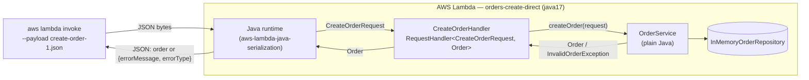
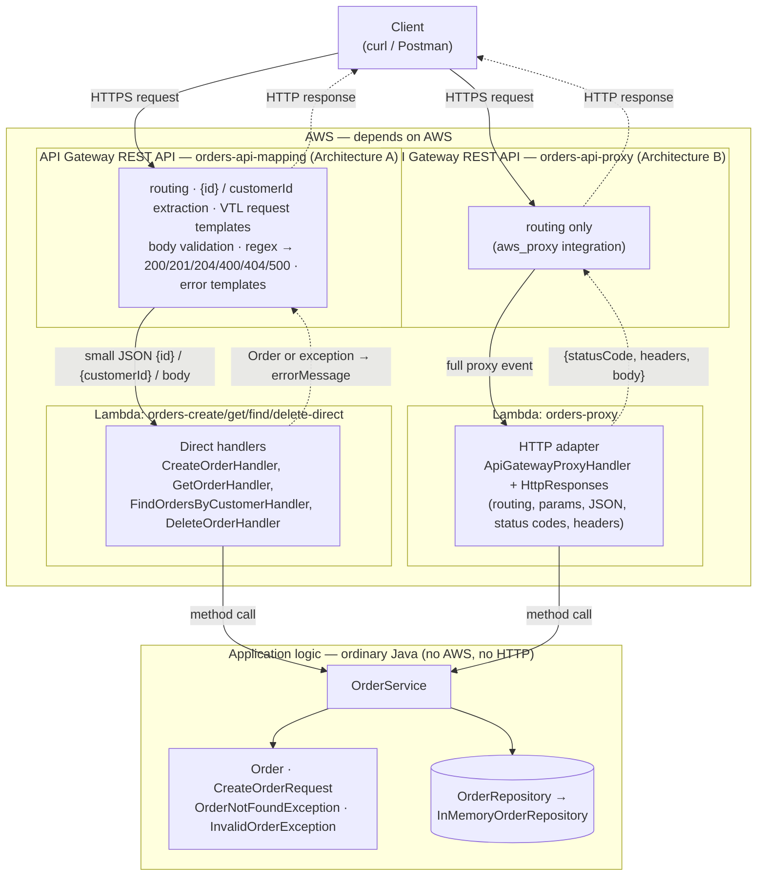

# Orders API — Serverless REST API with AWS Lambda and API Gateway

AREM — Microservicios y Arquitecturas sin Servidor · Escuela Colombiana de Ingeniería Julio Garavito

A small **Order Management API** written in plain Java 17 + Maven, deployed to **AWS Lambda** and exposed
through **Amazon API Gateway** using two different integration styles:

* **Architecture A** — API Gateway *non-proxy* (custom) integration with mapping templates.
* **Architecture B** — API Gateway *Lambda proxy* integration with a thin Java HTTP adapter.

---

## 1. API design (contract first)

### Resource model

An order:

```json
{
  "id": "ORD-001",
  "customerId": "CUST-42",
  "product": "MacBook Air",
  "quantity": 1
}
```

Every error, in every operation, uses the same JSON representation:

```json
{
  "error": "ORDER_NOT_FOUND",
  "message": "Order ORD-999 does not exist"
}
```

* `error` — stable, machine-readable code (clients can `switch` on it).
* `message` — human-readable explanation (may change, never parsed by clients).

| Error code           | HTTP | When                                                          |
|----------------------|------|---------------------------------------------------------------|
| `INVALID_ORDER`      | 400  | Body is missing/malformed or violates a validation rule       |
| `MISSING_CUSTOMER_ID`| 400  | `GET /orders` called without the `customerId` query parameter |
| `ORDER_NOT_FOUND`    | 404  | No order exists with the given id                             |
| `ROUTE_NOT_FOUND`    | 404  | Unknown path/method combination (proxy adapter only)          |
| `INTERNAL_ERROR`     | 500  | Any unexpected failure; no internal details are leaked        |

### Operations

#### Create an order — `POST /orders`

| Item              | Value |
|-------------------|-------|
| Path params       | — |
| Query params      | — |
| Request body      | `{"customerId": "CUST-42", "product": "MacBook Air", "quantity": 1}` |
| Success           | `201 Created` + created order (with the server-generated `id`) + `Location: /orders/{id}` header |
| Errors            | `400 INVALID_ORDER` (no body, malformed JSON, blank `customerId`/`product`, `quantity < 1`), `500 INTERNAL_ERROR` |

#### Retrieve an order — `GET /orders/{id}`

| Item              | Value |
|-------------------|-------|
| Path params       | `id` — order identifier, e.g. `ORD-42` |
| Query params      | — |
| Request body      | — |
| Success           | `200 OK` + the order |
| Errors            | `404 ORDER_NOT_FOUND`, `500 INTERNAL_ERROR` |

#### Find the orders of a customer — `GET /orders?customerId={customerId}`

| Item              | Value |
|-------------------|-------|
| Path params       | — |
| Query params      | `customerId` (required) |
| Request body      | — |
| Success           | `200 OK` + JSON array of orders (an **empty array** when the customer has no orders) |
| Errors            | `400 MISSING_CUSTOMER_ID`, `500 INTERNAL_ERROR` |

#### Delete an order — `DELETE /orders/{id}` (final challenge)

| Item              | Value |
|-------------------|-------|
| Path params       | `id` |
| Success           | `204 No Content` (empty body) |
| Errors            | `404 ORDER_NOT_FOUND`, `500 INTERNAL_ERROR` |

### Design questions

1. **What are the resources in your API?**
   One collection resource, `/orders`, and its item resource, `/orders/{id}`. Customers are not exposed as a
   resource in this version; they appear only as an attribute (`customerId`) used to filter the collection.

2. **Why `/orders/{id}` to retrieve a particular order?**
   The id *identifies* a single resource, so it belongs in the path: `/orders/ORD-42` is the URI of that order.
   It is stable, cacheable, bookmarkable, and the same URI is reused for other methods on the same resource
   (`DELETE /orders/{id}`, a future `PUT`). It is also the natural value for the `Location` header after a `POST`.

3. **Why is `customerId` a query parameter?**
   Searching by customer does not identify one resource; it *filters* the `/orders` collection. Query parameters
   are the conventional way to express optional filters/criteria over a collection and compose well
   (`?customerId=CUST-42&product=...` later) without inventing new resource hierarchies. A nested resource
   (`/customers/{id}/orders`) would also be valid, but it implies that customers are a first-class resource,
   which they are not in this API.

4. **What should `POST /orders` return on success?**
   `201 Created`, the representation of the created order including its server-generated `id`, and a
   `Location: /orders/{id}` header pointing to the new resource.

5. **What should the API return when an order does not exist?**
   `404 Not Found` with the error body `{"error":"ORDER_NOT_FOUND","message":"Order ORD-999 does not exist"}`.
   Not `200` with `null`, and not `500` — the request was valid, the resource simply is not there.

6. **What information should an error response contain?**
   A stable machine-readable code (`error`) and a human-readable description (`message`). The HTTP status code
   carries the category. It must **not** contain stack traces, class names or other internal details.

---

## 2. Part I — Application in plain Java

```
src/main/java/edu/eci/arem/orders/
├── domain/        Order, CreateOrderRequest, OrderNotFoundException, InvalidOrderException
└── application/   OrderService, OrderRepository (port), InMemoryOrderRepository
```

`OrderService` exposes:

```java
Order createOrder(CreateOrderRequest request);   // throws InvalidOrderException
Order getOrder(String id);                       // throws OrderNotFoundException
List<Order> getOrdersByCustomer(String customerId);
```

* Validation (business rules: required `customerId`/`product`, `quantity >= 1`) lives in `OrderService`.
* Failures are expressed with **domain exceptions**, never with status codes.
* Ids are generated by the repository (`ORD-43`, `ORD-44`, ...). Sample data: `ORD-001`, `ORD-002` (CUST-42)
  and `ORD-42` (CUST-7).

### Checkpoint 1

1. **Can the functionality be tested without AWS?** Yes. `OrderServiceTest` runs with plain JUnit 5 in
   milliseconds; no AWS account, SDK or emulator is involved.
2. **Does it require a web server?** No. There is no Tomcat/Jetty/Netty; `OrderService` is invoked as a
   normal Java object.
3. **Does it require Spring Boot?** No. Dependencies at this point: only JUnit (test scope).
4. **What does the generated JAR contain?** Only our compiled classes (`domain` and `application`
   packages) plus Maven metadata (`META-INF/MANIFEST.MF`, `pom.xml`, `pom.properties`) — ~17 KB, no
   third-party libraries.
5. **Which parts currently know about HTTP?** None. Not a single class imports anything HTTP related.

---

## 3. Part II — A Java function on AWS Lambda

The same JAR (`target/orders-api-1.0.0.jar`, shaded) is uploaded to every function; only the handler string
changes. Nothing in `OrderService` was redesigned for Lambda — the handlers are 3-line delegations.

| Function               | Handler                                                                    |
|------------------------|----------------------------------------------------------------------------|
| `orders-create-direct` | `edu.eci.arem.orders.lambda.direct.CreateOrderHandler::handleRequest`        |
| `orders-get-direct`    | `edu.eci.arem.orders.lambda.direct.GetOrderHandler::handleRequest`           |
| `orders-find-direct`   | `edu.eci.arem.orders.lambda.direct.FindOrdersByCustomerHandler::handleRequest` |
| `orders-delete-direct` | `edu.eci.arem.orders.lambda.direct.DeleteOrderHandler::handleRequest`        |
| `orders-proxy`         | `edu.eci.arem.orders.lambda.proxy.ApiGatewayProxyHandler::handleRequest`     |

Runtime `java17`, 512 MB, 15 s timeout ([screenshot](evidence/screenshots/60-lambda-functions.png)).

Manual invocation (payloads in [`events/direct/`](events/direct)):

```bash
aws lambda invoke --function-name orders-create-direct --cli-binary-format raw-in-base64-out \
  --payload file://events/direct/create-order-1.json out.json && cat out.json
```

| Input | Result | Evidence |
|-------|--------|----------|
| `{"customerId":"CUST-42","product":"MacBook Air","quantity":1}` | `{"id":"ORD-43","customerId":"CUST-42","product":"MacBook Air","quantity":1}` | [11](evidence/screenshots/11-lambda-create-1.png) |
| `{"customerId":"CUST-100","product":"Mechanical Keyboard","quantity":3}` | `{"id":"ORD-44",...}` | [12](evidence/screenshots/12-lambda-create-2.png) |
| `{... "quantity":0}` | `FunctionError: Unhandled`, `{"errorMessage":"INVALID_ORDER: quantity must be at least 1","errorType":"...InvalidOrderException","stackTrace":[...]}` | [13](evidence/screenshots/13-lambda-create-invalid.png) |
| `{"id":"ORD-42"}` → get | `{"id":"ORD-42","customerId":"CUST-7","product":"Keyboard","quantity":2}` | [14](evidence/screenshots/14-lambda-get.png) |
| `{"id":"ORD-999"}` → get | `errorMessage: "ORDER_NOT_FOUND: Order ORD-999 does not exist"` | [15](evidence/screenshots/15-lambda-get-missing.png) |
| `{"customerId":"CUST-42"}` → find | JSON **array** of 2 orders (`List<Order>`) | [16](evidence/screenshots/16-lambda-find.png) |

### Investigation — how does Lambda turn JSON into Java objects and back?

What the LLM explained, and what I then checked against the deployed function:

1. The Java managed runtime polls the Lambda **Runtime API** (`/runtime/invocation/next`) and receives the event
   as raw bytes (JSON).
2. It loads the handler class from the handler string and reads, **by reflection**, the generic types of
   `RequestHandler<I, O>` (here `I = CreateOrderRequest`, `O = Order`).
3. It deserializes the bytes into `I` with its own serialization library (`aws-lambda-java-serialization`, a
   shaded, pre-configured Jackson). The target must be a JavaBean: public no-arg constructor + setters.
   For classes from `aws-lambda-java-events` it uses special mix-ins.
4. It calls `handleRequest(input, context)` and serializes the return value `O` with the same library
   (getters → JSON properties; `List` → JSON array; `null`/`Void` → `null`).
5. If the handler throws, the runtime reports an error whose body is
   `{"errorMessage": e.getMessage(), "errorType": <class>, "stackTrace": [...]}` and the invoke response
   carries `FunctionError: Unhandled`. The invoke itself is still HTTP 200.
6. `RequestStreamHandler` is the alternative to opt out of this and receive the raw `InputStream`.

Experiments on the deployed function to verify it:

| Experiment | Observed | Conclusion | Evidence |
|------------|----------|------------|----------|
| Extra field `"color"`, client-supplied `"id":"HACKED-1"`, `"quantity":"2"` (string) | 200, `{"id":"ORD-45",...,"quantity":2}` | Unknown properties are **ignored**; the client cannot set the id (`CreateOrderRequest` has no `id`); the string `"2"` was **coerced** to `Integer` | [17](evidence/screenshots/17-lambda-extra-fields.png) |
| `"CustomerID"`, `"PRODUCT"` | `INVALID_ORDER: customerId is required` | Property matching is **case-sensitive**, by JavaBean name | [18](evidence/screenshots/18-lambda-case.png) |
| Payload `"just a string"` | `errorType: java.lang.RuntimeException`, `"An error occurred during JSON parsing"`, empty stack trace | Deserialization fails **before** our code runs; we cannot customize that error | [19](evidence/screenshots/19-lambda-not-object.png) |
| Handler throws a domain exception | `errorMessage` = `getMessage()` exactly | This is the string API Gateway (Architecture A) matches with its regex | [13](evidence/screenshots/13-lambda-create-invalid.png), [15](evidence/screenshots/15-lambda-get-missing.png) |

**Conclusion.** The runtime does the JSON ⇄ Java mapping for us, driven by the generic types of the handler, with
lenient defaults (unknown properties ignored, scalars coerced) but case-sensitive names. Because of that, Lambda
input/output types have to be plain JavaBeans — this is why `Order` and `CreateOrderRequest` are classes with
setters and not records.

### Checkpoint 2 — the actual solution



---

## 4. Part III & IV — Architecture A: API Gateway mapping templates (non-proxy)

Definition: [`apigateway/orders-api-mapping.yaml`](apigateway/orders-api-mapping.yaml) (OpenAPI 2 +
`x-amazon-apigateway-*` extensions, imported by `deploy/deploy.sh`). What is actually deployed was exported to
[`apigateway/exported/`](apigateway/exported).

```
Base URL: https://53zqfs5myi.execute-api.us-east-1.amazonaws.com/prod
```

### Request mapping — API Gateway builds the exact JSON each Java function expects

| Route | Integration request template | Lambda receives |
|-------|------------------------------|-----------------|
| `GET /orders/{id}` | `{"id": "$util.escapeJavaScript($input.params('id'))"}` | `{"id":"ORD-42"}` → `OrderIdInput` |
| `GET /orders?customerId=` | `{"customerId": "$util.escapeJavaScript($input.params('customerId'))"}` | `{"customerId":"CUST-42"}` → `CustomerQueryInput` |
| `POST /orders` | `$input.json('$')` (body as is) | `CreateOrderRequest` |
| `DELETE /orders/{id}` | same as GET by id | `OrderIdInput` |

Proof with `test-invoke-method` — the Java function never sees the HTTP request, only `{"id": "ORD-42"}`
([screenshot 20](evidence/screenshots/20-mapping-test-invoke.png)):

```
Method request path: {id=ORD-42}
Endpoint request body after transformations: {
  "id": "ORD-42"
}
Endpoint response body before transformations: {"id":"ORD-42","customerId":"CUST-7","product":"Keyboard","quantity":2}
```

### Response mapping — API Gateway chooses the status code

The Lambda either returns normally or fails with `errorMessage = "<CODE>: <description>"`.
Integration responses match that message with a regex and rewrite the body into our error format:

| Selection pattern (regex on `errorMessage`) | Status | Body template |
|---------------------------------------------|--------|---------------|
| *(default — success)* | 200 (`POST`: **201** + `Location` via `$context.responseOverride.header.Location`; `DELETE`: **204** with empty template) | Lambda output |
| `(?s)ORDER_NOT_FOUND:.*` | 404 | `{"error":"ORDER_NOT_FOUND","message":"<text after the code>"}` |
| `(?s)(INVALID_ORDER\|MISSING_CUSTOMER_ID):.*` | 400 | `{"error":"<code>","message":"<text>"}` |
| `(?s)(?!INVALID_ORDER:\|MISSING_CUSTOMER_ID:\|ORDER_NOT_FOUND:).+` | 500 | `{"error":"INTERNAL_ERROR","message":"Unexpected error"}` (stack trace never leaves AWS) |

API Gateway also has its own **request validator** on `POST` (JSON Schema with types only) and **gateway
responses** (`BAD_REQUEST_BODY`, `MISSING_AUTHENTICATION_TOKEN` → 404 `ROUTE_NOT_FOUND`, `DEFAULT_5XX`), so
errors produced before Lambda runs use the same error format.

### Tests from an HTTP client (curl)

| Request | Status | Evidence |
|---------|--------|----------|
| `GET /orders/ORD-42` | **200** order | [21](evidence/screenshots/21-mapping-get-200.png) |
| `GET /orders/ORD-999` | **404** `ORDER_NOT_FOUND` | [22](evidence/screenshots/22-mapping-get-404.png) |
| `GET /orders?customerId=CUST-42` | **200** array with 2 orders | [23](evidence/screenshots/23-mapping-query-cust42.png) |
| `GET /orders?customerId=CUST-100` | **200** `[]` | [24](evidence/screenshots/24-mapping-query-cust100.png) |
| `GET /orders` | **400** `MISSING_CUSTOMER_ID` | [25](evidence/screenshots/25-mapping-query-400.png) |
| `POST /orders` valid | **201** + `Location: /orders/ORD-46` | [26](evidence/screenshots/26-mapping-post-201.png) |
| `POST /orders` `quantity: 0` | **400** `INVALID_ORDER` (rule in Java) | [27](evidence/screenshots/27-mapping-post-400.png) |
| `POST /orders` `quantity: "one"` | **400** (API Gateway validator; Lambda not invoked) | [28](evidence/screenshots/28-mapping-post-malformed.png) |
| `GET /orders/ORD-46` (just created) | **404** ⚠️ see below | [29](evidence/screenshots/29-mapping-get-created.png) |
| `DELETE /orders/ORD-42` | **204** | [30](evidence/screenshots/30-mapping-delete-204.png) |
| `DELETE /orders/ORD-999` | **404** | [31](evidence/screenshots/31-mapping-delete-404.png) |
| `GET /customers` | **404** `ROUTE_NOT_FOUND` (gateway response) | [32](evidence/screenshots/32-mapping-unknown-route.png) |

⚠️ **Finding:** the order created by `POST` (in `orders-create-direct`) is **not** found by `GET`
(`orders-get-direct`). Each function has its own execution environment and therefore its own in-memory
repository. One-function-per-operation makes it obvious that in-memory data is not shared state — a real
system needs external storage such as DynamoDB. (The id is `ORD-46` and not `ORD-43` because the same warm
environment had already handled the manual invocations of Part II.)

---

## 5. HTTP semantics and Checkpoint 3

| Outcome | Status | Who decides in Architecture A |
|---------|--------|-------------------------------|
| Successful retrieval | 200 | default integration response |
| Successful creation | 201 + `Location` | default integration response of `POST` + response template |
| Deleted | 204 | default integration response of `DELETE` |
| Invalid input | 400 | regex on `INVALID_ORDER:` / `MISSING_CUSTOMER_ID:`, or the request validator |
| Not found | 404 | regex on `ORDER_NOT_FOUND:` |
| Unexpected | 500 | negative-lookahead regex / `DEFAULT_5XX` |

**What API Gateway is responsible for in Architecture A:** routing (resource + method); extracting the path
parameter `{id}`; extracting the query parameter `customerId`; transforming requests (VTL templates); validating
body types (JSON Schema); transforming responses (errors to `{error, message}`, empty body for 204); choosing
status codes (regex over `errorMessage`); adding the `Location` header; formatting its own errors (gateway
responses).

**Advantages**
- The Java functions are almost pure: they receive `{"id": ...}` and return an `Order`. No HTTP classes.
- The contract (methods, statuses, schemas, headers) is declared in one file and can be exported/documented.
- Some invalid requests are rejected before paying for a Lambda invocation (validator, unknown routes).

**Disadvantages**
- Logic spread over 2 places and 2 languages (Java + VTL + regex). Status codes depend on a **string
  convention** (`"ORDER_NOT_FOUND: ..."`) between the exception message and a regex — rename the prefix and you
  silently get a 200/500.
- VTL templates cannot be unit-tested locally; the only feedback loop is deploying and calling (or
  `test-invoke-method`). Each new operation repeats the same 3–4 response mappings.
- The domain exceptions had to adopt a message format dictated by the integration layer, which is a leak of
  infrastructure into the domain.
- Hard to read for someone who does not know API Gateway; vendor lock-in of the HTTP layer.

---

## 6. Part V — Lambda proxy integration: the event

With `type: aws_proxy` API Gateway does no transformation and sends the whole HTTP request to the function.
Real event captured with `test-invoke-method` (credentials redacted):
[`events/proxy/api-gateway-proxy-event.json`](events/proxy/api-gateway-proxy-event.json)
([screenshot 40](evidence/screenshots/40-proxy-event.png)).

| Information | Where it appears in the event | Java accessor (`APIGatewayProxyRequestEvent`) |
|-------------|-------------------------------|-----------------------------------------------|
| HTTP method | `httpMethod` (also `requestContext.httpMethod`) | `getHttpMethod()` |
| Path | `path` (actual) and `resource` (template, e.g. `/orders/{id}`) | `getPath()`, `getResource()` |
| Path parameters | `pathParameters` → `{"id": "ORD-42"}` (or `null`) | `getPathParameters()` |
| Query parameters | `queryStringParameters` / `multiValueQueryStringParameters` | `getQueryStringParameters()` |
| Headers | `headers` / `multiValueHeaders` | `getHeaders()` |
| Request body | `body` — always a **string** (or `null`), Base64 if `isBase64Encoded` | `getBody()`, `getIsBase64Encoded()` |

The function must answer with `{"statusCode": ..., "headers": {...}, "body": "<string>"}`
(`APIGatewayProxyResponseEvent`). API Gateway forwards that as the HTTP response.

---

## 7. Part V — the HTTP adapter (Architecture B)

```
Base URL: https://qdkefe66a7.execute-api.us-east-1.amazonaws.com/prod
```

[`ApiGatewayProxyHandler`](src/main/java/edu/eci/arem/orders/lambda/proxy/ApiGatewayProxyHandler.java) is the
only class that knows about API Gateway, headers and status codes. It:

1. routes on `httpMethod + resource` (`"GET /orders/{id}"`, ...);
2. extracts `pathParameters.id`, `queryStringParameters.customerId`, and the body (decoding Base64 and parsing
   JSON with Jackson);
3. calls `OrderService` — which still deals only with `Order`, `customerId`, `product`, `quantity`;
4. translates the outcome: return value → 200/201/204, `InvalidOrderException` or bad JSON → 400,
   `OrderNotFoundException` → 404, unknown route → 404, any other `RuntimeException` → 500 with a generic body
   (the detail goes to CloudWatch logs only). `HttpResponses` builds the response objects.

A `Location: /orders/{id}` header is returned on 201: it is the URI of the new resource, which is what
RFC 9110 says a 201 should identify, and it lets a client follow it without knowing how URLs are built.

Since the adapter is a plain class, it is tested locally with hand-built events
(`ApiGatewayProxyHandlerTest`, 14 tests, no AWS).

| Request | Status | Evidence |
|---------|--------|----------|
| `POST /orders` | **201** + `Location: /orders/ORD-43` | [41](evidence/screenshots/41-proxy-post-201.png) |
| `GET /orders/ORD-43` (just created) | **200** — same function, same warm environment | [42](evidence/screenshots/42-proxy-get-created.png) |
| `GET /orders/ORD-42` | **200** | [43](evidence/screenshots/43-proxy-get-200.png) |
| `GET /orders/ORD-999` | **404** `ORDER_NOT_FOUND` | [44](evidence/screenshots/44-proxy-get-404.png) |
| `GET /orders?customerId=CUST-42` | **200** (includes ORD-43) | [45](evidence/screenshots/45-proxy-query-cust42.png) |
| `GET /orders?customerId=CUST-100` | **200** `[]` | [46](evidence/screenshots/46-proxy-query-cust100.png) |
| `GET /orders` | **400** `MISSING_CUSTOMER_ID` | [47](evidence/screenshots/47-proxy-query-400.png) |
| `POST /orders` `quantity: 0` | **400** `INVALID_ORDER` | [48](evidence/screenshots/48-proxy-post-400.png) |
| `POST /orders` `{not json` | **400** `INVALID_ORDER` (adapter) | [49](evidence/screenshots/49-proxy-post-malformed.png) |
| `DELETE /orders/ORD-42` | **204** | [50](evidence/screenshots/50-proxy-delete-204.png) |
| `GET` then `DELETE /orders/ORD-42` again | **404**, **404** | [51](evidence/screenshots/51-proxy-delete-again.png) |
| `GET /customers` | **404** `ROUTE_NOT_FOUND` | [52](evidence/screenshots/52-proxy-unknown-route.png) |

---

## 8. Comparing the two architectures

1. **More API Gateway configuration?** A, by far: `orders-api-mapping.yaml` has request templates, 3–4
   integration responses per method with regexes and VTL, a validator and a model. B's file only lists
   routes pointing to one function.
2. **More Java infrastructure code?** B: `ApiGatewayProxyHandler` + `HttpResponses` (routing, parameter
   extraction, JSON, status codes, ~150 lines). A's handlers are 3-line delegations plus two input DTOs.
3. **Easier to test locally?** B. The whole HTTP behaviour (status codes, headers, error bodies) is covered by
   JUnit. In A the status-code logic lives in VTL/regex and can only be verified after deploying.
4. **Where are status codes defined?** A: in API Gateway integration responses (regex over `errorMessage`)
   and gateway responses. B: in Java, in `ApiGatewayProxyHandler.handleRequest`.
5. **From 3 to 30 operations?** A: 30 methods × (request template + ~4 response mappings), ~30 functions, all
   copy-pasted VTL, and every new error code means touching the regexes of every method. B: 30 cases in a
   router; at that size the hand-written `switch` should become a small routing table or a lightweight
   framework, and one big function may need splitting by bounded context (cold start, permissions, blast
   radius). B scales better in effort; A gives finer per-operation control.
6. **Cleaner Java business logic?** Equally clean `OrderService` in both — that was the point of keeping it
   independent. But A forced a format on exception messages; B leaves the domain completely free.
7. **Easier for another developer?** B: everything is in Java, visible in one class, debuggable and testable.
   A requires knowing API Gateway's VTL, selection patterns and where to look in the console.
8. **For a larger system?** B (proxy + thin adapter), with the business logic still isolated behind it. The
   HTTP contract becomes code that is reviewed, versioned and tested like the rest. I would still use API
   Gateway for what it is good at — routing, authentication, throttling, request size limits, CORS — and
   would keep the OpenAPI document as the published contract. A remains interesting when the integration
   target is not your own code (e.g. API Gateway → DynamoDB or SQS directly, with no Lambda at all).

---

## 9. Final challenge — `DELETE /orders/{id}`

### Prediction (written and committed *before* implementing the feature)

1. **Which Java classes should change?**
   `OrderRepository` (+`deleteById`), `InMemoryOrderRepository`, `OrderService` (+`deleteOrder(String id)`),
   `ApiGatewayProxyHandler` (new route `DELETE /orders/{id}`) and, for Architecture A, a new
   `DeleteOrderHandler`. `Order`, `CreateOrderRequest` and the exceptions should **not** change:
   `OrderNotFoundException` already expresses "it does not exist".
2. **Do you need a new Lambda function?**
   Architecture B: **no** — the single proxy function already serves the whole API; only a new route in the
   adapter. Architecture A: **yes** (`orders-delete-direct`), because A was designed one-function-per-operation.
3. **Does API Gateway configuration need to change?**
   Yes, in both. A: new method with request template, and integration responses for 204 / 404 / 500.
   B: only a new `DELETE` method on `/orders/{id}` pointing to the same proxy function (it would need no change
   at all if the resource had used `ANY` or `{proxy+}`).
4. **Where should the deletion logic reside?** In `OrderService.deleteOrder` (+ the repository). It is
   application logic: "an order can be deleted only if it exists".
5. **Where should the decision to return 204 or 404 reside?** Not in the service — it only returns normally
   or throws `OrderNotFoundException`. B: in the HTTP adapter (`ApiGatewayProxyHandler`). A: in API Gateway
   integration responses (default → 204, regex `ORDER_NOT_FOUND:.*` → 404).
6. **Which tests should be added?** Service: delete an existing order; deleted order is no longer retrievable
   nor listed for its customer; delete a missing order throws; deleting twice → second time throws.
   Adapter: `DELETE` existing → 204 with empty body; `DELETE` missing → 404 with the error body.
   Direct handler: delegates and propagates the `ORDER_NOT_FOUND:` message.

### What actually happened vs. the prediction

| Question | Prediction | What the agent proposed / what was implemented | Match |
|----------|------------|-----------------------------------------------|-------|
| Classes that change | Repository, `InMemoryOrderRepository`, `OrderService`, proxy handler, new `DeleteOrderHandler` | Exactly those (+ tests). `Order` and exceptions unchanged | ✅ |
| New Lambda | B no, A yes | `orders-proxy` reused; `orders-delete-direct` added | ✅ |
| API Gateway changes | Both | A: new `delete` method with request template and 204/404/500 responses. B: one `delete` method → same function | ✅ |
| Deletion logic | `OrderService.deleteOrder` | `repository.deleteById` returns `boolean`; the service throws `OrderNotFoundException` when it is `false` | ✅ |
| 204 vs 404 | A: gateway, B: adapter | Same. A needed an empty response template (`#set($noBody = '')`) because the `Void` handler returns `null` and the passthrough body would have been the text `null` | ✅ (detail not predicted) |
| Tests | service + adapter + handler | 3 service tests, 2 adapter tests, 2 direct-handler tests | ✅ |

Not predicted: API Gateway adds `Content-Type: application/json` to the 204 response even though the adapter
sends no headers and no body (seen in [50](evidence/screenshots/50-proxy-delete-204.png)). It is harmless. A
second `DELETE` of the same id returns 404, so `DELETE` is idempotent in its effect on the server, not in its
status code — this is allowed by HTTP.

---

## 10. AI-assisted development

I used Claude Code (an LLM coding agent) as an engineering collaborator. The main prompt for Part V was:

```
I have a Java 17 AWS Lambda application implementing an Orders API (OrderService, Order,
CreateOrderRequest, domain exceptions). I want to expose it through Amazon API Gateway twice:
(A) non-proxy integration with mapping templates and (B) Lambda proxy integration.
Operations: POST /orders, GET /orders/{id}, GET /orders?customerId=, later DELETE /orders/{id}.
Keep the application logic independent from AWS-specific classes.
Before generating code: 1. propose the architecture; 2. identify which existing files change;
3. identify new classes; 4. explain where HTTP responsibilities (status codes, headers, errors)
will reside in each variant. Do not implement anything until the architecture has been explained.
Deploy with the AWS CLI only (no SAM/CDK) and keep the API Gateway configuration in files.
```

### Critique of the agent's decisions

**1. One Lambda per operation in Architecture A, one Lambda for the whole API in B.**
- *Why it proposed it:* it is the "natural" fit of each style: non-proxy integrations map one method to one
  typed function (`RequestHandler<OrderIdInput, Order>`), and proxy integrations push towards a single router.
- *Do I agree?* Partially. It makes the comparison very clear, but it hides a cost: state is not shared
  between functions. The deployed API returned **404 for an order it had just created**
  ([29](evidence/screenshots/29-mapping-get-created.png)). The agent did not flag this up front; I found it
  in the evidence.
- *Alternative:* a single non-proxy function that dispatches on an `"operation"` field set by the mapping
  template, or (the real fix) external storage such as DynamoDB, which makes function granularity irrelevant
  for state.
- *What I implemented:* kept the agent's split, because the workshop says in-memory data is not persistent
  anyway, and documented the finding as an argument about where state must live.

**2. Encoding the error code in the exception message (`"ORDER_NOT_FOUND: Order X does not exist"`).**
- *Why it proposed it:* in a non-proxy integration API Gateway can only see `errorMessage`; a stable prefix
  is the simplest thing a selection regex can match.
- *Do I agree?* It works, but it makes the domain layer obey a convention that only exists because of API
  Gateway, and it turns a refactor of a message into a production bug that no unit test of the service
  would catch. (The agent did add handler tests that assert the messages match the gateway regexes, which
  reduces the risk.)
- *Alternative:* keep domain messages free and let the direct handlers catch domain exceptions and rethrow an
  infrastructure exception (`ApiError("404", ...)`) whose message is the integration contract; or return an
  explicit result object.
- *What I implemented:* the prefix, plus `getDescription()` so the proxy adapter can send the message without
  the code. For a real system I would choose the wrapping alternative or simply Architecture B.

**3. Where validation lives.**
- *Why it proposed it:* business rules (required fields, `quantity >= 1`) in `OrderService` so both
  architectures and the tests share them; in A, an additional API Gateway JSON-Schema model that checks types
  only.
- *Do I agree?* Yes with the main decision. I questioned the gateway model: it duplicates part of the contract.
  The agent's argument was that the model avoids invoking Lambda for structurally wrong bodies and that it
  deliberately does **not** repeat business rules (`required`, `minimum`) to avoid two sources of truth.
- *Alternative:* full JSON Schema in API Gateway (rules duplicated, but rejected earlier), or no model at all
  (Lambda's serializer fails with a generic `RuntimeException` that A would map to 500 — wrong status).
- *What I implemented:* types-only model in A; JSON parsing errors mapped to 400 in B's adapter; rules in Java.

**4. Using `aws-lambda-java-events` types in the adapter, and putting everything in one Maven module.**
- *Why it proposed it:* typed event/response classes are the documented way, and one module keeps the
  workshop small.
- *Do I agree?* For the adapter, yes. But the single module means `aws-lambda-java-core` is on the classpath of
  the application packages; nothing *prevents* `OrderService` from importing AWS classes — independence is
  kept by discipline, not by the build.
- *Alternative:* two modules (`orders-core` with no AWS dependency, `orders-lambda` depending on it), or an
  ArchUnit test forbidding `com.amazonaws` imports in `domain`/`application`.
- *What I implemented:* the single module (as the workshop structure suggests), documenting the trade-off.

**5. Routing in B with a `switch` on `httpMethod + " " + resource`.** The agent chose `resource` (the template,
`/orders/{id}`) instead of parsing `path`, which avoids writing a path matcher — a good decision that I kept.
For 30 routes I would replace the `switch` with a route table.

---

## 11. Final API and unexpected errors

| Method & URL | Success | Errors |
|--------------|---------|--------|
| `POST /orders` | 201 + `Location` | 400, 500 |
| `GET /orders/{id}` | 200 | 404, 500 |
| `GET /orders?customerId={customerId}` | 200 (array, possibly empty) | 400, 500 |
| `DELETE /orders/{id}` | 204 | 404, 500 |

**Unexpected internal error.**
- B: any `RuntimeException` not mapped to a domain error is caught in the adapter and becomes
  `500 {"error":"INTERNAL_ERROR","message":"Unexpected error"}`; the exception is written to the Lambda
  log (CloudWatch) and never to the client. Verified locally by
  `ApiGatewayProxyHandlerTest.unexpectedFailureIs500WithoutInternalDetails` (a repository that throws). If the
  function itself crashes or times out, API Gateway returns 502 and the `DEFAULT_5XX` gateway response keeps
  the same error format.
- A: any `errorMessage` not starting with a known code (including `Task timed out`) matches the
  negative-lookahead regex → `500 INTERNAL_ERROR`; the Lambda's `stackTrace` is dropped by the template.

---

## 12. Final architecture



Solid arrows are requests; dotted arrows are responses. Everything inside **AWS** depends on AWS (API Gateway
configuration, Lambda handlers using `aws-lambda-java-core`/`-events`). Everything inside **Application logic**
is plain Java and is tested without AWS.

---

## 13. How to build, test and deploy

Requirements: JDK 17+, Maven 3.9+, AWS CLI v2, Git Bash (on Windows) and an IAM identity with the
permissions in [`deploy/iam-deployer-policy.json`](deploy/iam-deployer-policy.json).

```bash
mvn test                      # 38 unit tests, no AWS needed
mvn package                   # target/orders-api-1.0.0.jar (shaded, ready for Lambda)
./deploy/deploy.sh            # IAM role + 5 Lambda functions + 2 REST APIs; writes deploy/outputs.env
source deploy/outputs.env     # MAPPING_URL and PROXY_URL
curl -i "$PROXY_URL/orders/ORD-42"
./evidence/tools/run-aws-evidence.sh   # optional: re-deploys and regenerates all the evidence
./deploy/teardown.sh          # delete everything
```

With an AWS Academy Learner Lab (where roles cannot be created):
`LAMBDA_ROLE_ARN=arn:aws:iam::<account>:role/LabRole ./deploy/deploy.sh`.

Repository layout:

```
├── pom.xml
├── src/main/java/edu/eci/arem/orders/
│   ├── domain/          Order, CreateOrderRequest, exceptions            (plain Java)
│   ├── application/     OrderService, OrderRepository, InMemory...      (plain Java)
│   └── lambda/
│       ├── OrderServiceProvider.java                                     (composition root)
│       ├── direct/      handlers for Architecture A                      (AWS)
│       └── proxy/       ApiGatewayProxyHandler, HttpResponses (B)        (AWS)
├── src/test/java/...    OrderServiceTest, DirectHandlersTest, ApiGatewayProxyHandlerTest
├── apigateway/          OpenAPI definitions of both APIs (+ exported/ from AWS)
├── deploy/              deploy.sh, teardown.sh, config.sh, IAM policies
├── events/              direct invocation payloads and a real proxy event
└── evidence/            captured command output (.txt) and screenshots/ (.png)
```

---

## 14. Evidence and demonstration

Every screenshot in [`evidence/screenshots/`](evidence/screenshots) was produced from the real output of
the command, which is saved next to it as `.txt` in [`evidence/`](evidence). The commands were run on Windows 11
(Git Bash in Windows Terminal) against the deployed account in `us-east-1`. Main ones:

| Step | Screenshot |
|------|-----------|
| `mvn test` | [01](evidence/screenshots/01-mvn-test.png) |
| `mvn package` | [02](evidence/screenshots/02-mvn-package.png) |
| Deploy | [10](evidence/screenshots/10-deploy.png) |
| Direct Lambda invocation | [11](evidence/screenshots/11-lambda-create-1.png) |
| Mapping template in action | [20](evidence/screenshots/20-mapping-test-invoke.png) |
| POST 201 / GET 200 / 404 / 400 / DELETE 204 (proxy) | [41](evidence/screenshots/41-proxy-post-201.png) · [43](evidence/screenshots/43-proxy-get-200.png) · [44](evidence/screenshots/44-proxy-get-404.png) · [48](evidence/screenshots/48-proxy-post-400.png) · [50](evidence/screenshots/50-proxy-delete-204.png) |
| Deployed resources | [60](evidence/screenshots/60-lambda-functions.png) · [61](evidence/screenshots/61-rest-apis.png) |

**Video:** _link pending_
