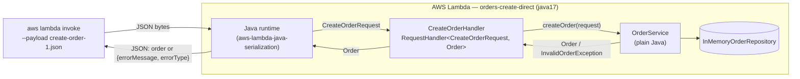

# Orders API — Serverless REST API with AWS Lambda and API Gateway

AREM — Microservicios y Arquitecturas sin Servidor · Escuela Colombiana de Ingeniería Julio Garavito

A small **Order Management API** written in plain Java 17 + Maven, deployed to **AWS Lambda** and exposed
through **Amazon API Gateway** using two different integration styles:

* **Architecture A** — API Gateway *non-proxy* (custom) integration with mapping templates.
* **Architecture B** — API Gateway *Lambda proxy* integration with a thin Java HTTP adapter.

---

## 1. API design (contract first)

### Resource model

An order:

```json
{
  "id": "ORD-001",
  "customerId": "CUST-42",
  "product": "MacBook Air",
  "quantity": 1
}
```

Every error, in every operation, uses the same JSON representation:

```json
{
  "error": "ORDER_NOT_FOUND",
  "message": "Order ORD-999 does not exist"
}
```

* `error` — stable, machine-readable code (clients can `switch` on it).
* `message` — human-readable explanation (may change, never parsed by clients).

| Error code           | HTTP | When                                                          |
|----------------------|------|---------------------------------------------------------------|
| `INVALID_ORDER`      | 400  | Body is missing/malformed or violates a validation rule       |
| `MISSING_CUSTOMER_ID`| 400  | `GET /orders` called without the `customerId` query parameter |
| `ORDER_NOT_FOUND`    | 404  | No order exists with the given id                             |
| `ROUTE_NOT_FOUND`    | 404  | Unknown path/method combination (proxy adapter only)          |
| `INTERNAL_ERROR`     | 500  | Any unexpected failure; no internal details are leaked        |

### Operations

#### Create an order — `POST /orders`

| Item              | Value |
|-------------------|-------|
| Path params       | — |
| Query params      | — |
| Request body      | `{"customerId": "CUST-42", "product": "MacBook Air", "quantity": 1}` |
| Success           | `201 Created` + created order (with the server-generated `id`) + `Location: /orders/{id}` header |
| Errors            | `400 INVALID_ORDER` (no body, malformed JSON, blank `customerId`/`product`, `quantity < 1`), `500 INTERNAL_ERROR` |

#### Retrieve an order — `GET /orders/{id}`

| Item              | Value |
|-------------------|-------|
| Path params       | `id` — order identifier, e.g. `ORD-42` |
| Query params      | — |
| Request body      | — |
| Success           | `200 OK` + the order |
| Errors            | `404 ORDER_NOT_FOUND`, `500 INTERNAL_ERROR` |

#### Find the orders of a customer — `GET /orders?customerId={customerId}`

| Item              | Value |
|-------------------|-------|
| Path params       | — |
| Query params      | `customerId` (required) |
| Request body      | — |
| Success           | `200 OK` + JSON array of orders (an **empty array** when the customer has no orders) |
| Errors            | `400 MISSING_CUSTOMER_ID`, `500 INTERNAL_ERROR` |

#### Delete an order — `DELETE /orders/{id}` (final challenge)

| Item              | Value |
|-------------------|-------|
| Path params       | `id` |
| Success           | `204 No Content` (empty body) |
| Errors            | `404 ORDER_NOT_FOUND`, `500 INTERNAL_ERROR` |

### Design questions

1. **What are the resources in your API?**
   One collection resource, `/orders`, and its item resource, `/orders/{id}`. Customers are not exposed as a
   resource in this version; they appear only as an attribute (`customerId`) used to filter the collection.

2. **Why `/orders/{id}` to retrieve a particular order?**
   The id *identifies* a single resource, so it belongs in the path: `/orders/ORD-42` is the URI of that order.
   It is stable, cacheable, bookmarkable, and the same URI is reused for other methods on the same resource
   (`DELETE /orders/{id}`, a future `PUT`). It is also the natural value for the `Location` header after a `POST`.

3. **Why is `customerId` a query parameter?**
   Searching by customer does not identify one resource; it *filters* the `/orders` collection. Query parameters
   are the conventional way to express optional filters/criteria over a collection and compose well
   (`?customerId=CUST-42&product=...` later) without inventing new resource hierarchies. A nested resource
   (`/customers/{id}/orders`) would also be valid, but it implies that customers are a first-class resource,
   which they are not in this API.

4. **What should `POST /orders` return on success?**
   `201 Created`, the representation of the created order including its server-generated `id`, and a
   `Location: /orders/{id}` header pointing to the new resource.

5. **What should the API return when an order does not exist?**
   `404 Not Found` with the error body `{"error":"ORDER_NOT_FOUND","message":"Order ORD-999 does not exist"}`.
   Not `200` with `null`, and not `500` — the request was valid, the resource simply is not there.

6. **What information should an error response contain?**
   A stable machine-readable code (`error`) and a human-readable description (`message`). The HTTP status code
   carries the category. It must **not** contain stack traces, class names or other internal details.

---

## 2. Part I — Application in plain Java

```
src/main/java/edu/eci/arem/orders/
├── domain/        Order, CreateOrderRequest, OrderNotFoundException, InvalidOrderException
└── application/   OrderService, OrderRepository (port), InMemoryOrderRepository
```

`OrderService` exposes:

```java
Order createOrder(CreateOrderRequest request);   // throws InvalidOrderException
Order getOrder(String id);                       // throws OrderNotFoundException
List<Order> getOrdersByCustomer(String customerId);
```

* Validation (business rules: required `customerId`/`product`, `quantity >= 1`) lives in `OrderService`.
* Failures are expressed with **domain exceptions**, never with status codes.
* Ids are generated by the repository (`ORD-43`, `ORD-44`, ...). Sample data: `ORD-001`, `ORD-002` (CUST-42)
  and `ORD-42` (CUST-7).

### Checkpoint 1

1. **Can the functionality be tested without AWS?** Yes. `OrderServiceTest` runs with plain JUnit 5 in
   milliseconds; no AWS account, SDK or emulator is involved.
2. **Does it require a web server?** No. There is no Tomcat/Jetty/Netty; `OrderService` is invoked as a
   normal Java object.
3. **Does it require Spring Boot?** No. Dependencies at this point: only JUnit (test scope).
4. **What does the generated JAR contain?** Only our compiled classes (`domain` and `application`
   packages) plus Maven metadata (`META-INF/MANIFEST.MF`, `pom.xml`, `pom.properties`) — ~17 KB, no
   third-party libraries.
5. **Which parts currently know about HTTP?** None. Not a single class imports anything HTTP related.

---

## 3. Part II — A Java function on AWS Lambda

The same JAR (`target/orders-api-1.0.0.jar`, shaded) is uploaded to every function; only the handler string
changes. Nothing in `OrderService` was redesigned for Lambda — the handlers are 3-line delegations.

| Function               | Handler                                                                    |
|------------------------|----------------------------------------------------------------------------|
| `orders-create-direct` | `edu.eci.arem.orders.lambda.direct.CreateOrderHandler::handleRequest`        |
| `orders-get-direct`    | `edu.eci.arem.orders.lambda.direct.GetOrderHandler::handleRequest`           |
| `orders-find-direct`   | `edu.eci.arem.orders.lambda.direct.FindOrdersByCustomerHandler::handleRequest` |
| `orders-delete-direct` | `edu.eci.arem.orders.lambda.direct.DeleteOrderHandler::handleRequest`        |
| `orders-proxy`         | `edu.eci.arem.orders.lambda.proxy.ApiGatewayProxyHandler::handleRequest`     |

Runtime `java17`, 512 MB, 15 s timeout ([screenshot](evidence/screenshots/60-lambda-functions.png)).

Manual invocation (payloads in [`events/direct/`](events/direct)):

```bash
aws lambda invoke --function-name orders-create-direct --cli-binary-format raw-in-base64-out \
  --payload file://events/direct/create-order-1.json out.json && cat out.json
```

| Input | Result | Evidence |
|-------|--------|----------|
| `{"customerId":"CUST-42","product":"MacBook Air","quantity":1}` | `{"id":"ORD-43","customerId":"CUST-42","product":"MacBook Air","quantity":1}` | [11](evidence/screenshots/11-lambda-create-1.png) |
| `{"customerId":"CUST-100","product":"Mechanical Keyboard","quantity":3}` | `{"id":"ORD-44",...}` | [12](evidence/screenshots/12-lambda-create-2.png) |
| `{... "quantity":0}` | `FunctionError: Unhandled`, `{"errorMessage":"INVALID_ORDER: quantity must be at least 1","errorType":"...InvalidOrderException","stackTrace":[...]}` | [13](evidence/screenshots/13-lambda-create-invalid.png) |
| `{"id":"ORD-42"}` → get | `{"id":"ORD-42","customerId":"CUST-7","product":"Keyboard","quantity":2}` | [14](evidence/screenshots/14-lambda-get.png) |
| `{"id":"ORD-999"}` → get | `errorMessage: "ORDER_NOT_FOUND: Order ORD-999 does not exist"` | [15](evidence/screenshots/15-lambda-get-missing.png) |
| `{"customerId":"CUST-42"}` → find | JSON **array** of 2 orders (`List<Order>`) | [16](evidence/screenshots/16-lambda-find.png) |

### Investigation — how does Lambda turn JSON into Java objects and back?

What the LLM explained, and what I then checked against the deployed function:

1. The Java managed runtime polls the Lambda **Runtime API** (`/runtime/invocation/next`) and receives the event
   as raw bytes (JSON).
2. It loads the handler class from the handler string and reads, **by reflection**, the generic types of
   `RequestHandler<I, O>` (here `I = CreateOrderRequest`, `O = Order`).
3. It deserializes the bytes into `I` with its own serialization library (`aws-lambda-java-serialization`, a
   shaded, pre-configured Jackson). The target must be a JavaBean: public no-arg constructor + setters.
   For classes from `aws-lambda-java-events` it uses special mix-ins.
4. It calls `handleRequest(input, context)` and serializes the return value `O` with the same library
   (getters → JSON properties; `List` → JSON array; `null`/`Void` → `null`).
5. If the handler throws, the runtime reports an error whose body is
   `{"errorMessage": e.getMessage(), "errorType": <class>, "stackTrace": [...]}` and the invoke response
   carries `FunctionError: Unhandled`. The invoke itself is still HTTP 200.
6. `RequestStreamHandler` is the alternative to opt out of this and receive the raw `InputStream`.

Experiments on the deployed function to verify it:

| Experiment | Observed | Conclusion | Evidence |
|------------|----------|------------|----------|
| Extra field `"color"`, client-supplied `"id":"HACKED-1"`, `"quantity":"2"` (string) | 200, `{"id":"ORD-45",...,"quantity":2}` | Unknown properties are **ignored**; the client cannot set the id (`CreateOrderRequest` has no `id`); the string `"2"` was **coerced** to `Integer` | [17](evidence/screenshots/17-lambda-extra-fields.png) |
| `"CustomerID"`, `"PRODUCT"` | `INVALID_ORDER: customerId is required` | Property matching is **case-sensitive**, by JavaBean name | [18](evidence/screenshots/18-lambda-case.png) |
| Payload `"just a string"` | `errorType: java.lang.RuntimeException`, `"An error occurred during JSON parsing"`, empty stack trace | Deserialization fails **before** our code runs; we cannot customize that error | [19](evidence/screenshots/19-lambda-not-object.png) |
| Handler throws a domain exception | `errorMessage` = `getMessage()` exactly | This is the string API Gateway (Architecture A) matches with its regex | [13](evidence/screenshots/13-lambda-create-invalid.png), [15](evidence/screenshots/15-lambda-get-missing.png) |

**Conclusion.** The runtime does the JSON ⇄ Java mapping for us, driven by the generic types of the handler, with
lenient defaults (unknown properties ignored, scalars coerced) but case-sensitive names. Because of that, Lambda
input/output types have to be plain JavaBeans — this is why `Order` and `CreateOrderRequest` are classes with
setters and not records.

### Checkpoint 2 — the actual solution



---

## 4. Part III & IV — Architecture A: API Gateway mapping templates (non-proxy)

Definition: [`apigateway/orders-api-mapping.yaml`](apigateway/orders-api-mapping.yaml) (OpenAPI 2 +
`x-amazon-apigateway-*` extensions, imported by `deploy/deploy.sh`). What is actually deployed was exported to
[`apigateway/exported/`](apigateway/exported).

```
Base URL: https://53zqfs5myi.execute-api.us-east-1.amazonaws.com/prod
```

### Request mapping — API Gateway builds the exact JSON each Java function expects

| Route | Integration request template | Lambda receives |
|-------|------------------------------|-----------------|
| `GET /orders/{id}` | `{"id": "$util.escapeJavaScript($input.params('id'))"}` | `{"id":"ORD-42"}` → `OrderIdInput` |
| `GET /orders?customerId=` | `{"customerId": "$util.escapeJavaScript($input.params('customerId'))"}` | `{"customerId":"CUST-42"}` → `CustomerQueryInput` |
| `POST /orders` | `$input.json('$')` (body as is) | `CreateOrderRequest` |
| `DELETE /orders/{id}` | same as GET by id | `OrderIdInput` |

Proof with `test-invoke-method` — the Java function never sees the HTTP request, only `{"id": "ORD-42"}`
([screenshot 20](evidence/screenshots/20-mapping-test-invoke.png)):

```
Method request path: {id=ORD-42}
Endpoint request body after transformations: {
  "id": "ORD-42"
}
Endpoint response body before transformations: {"id":"ORD-42","customerId":"CUST-7","product":"Keyboard","quantity":2}
```

### Response mapping — API Gateway chooses the status code

The Lambda either returns normally or fails with `errorMessage = "<CODE>: <description>"`.
Integration responses match that message with a regex and rewrite the body into our error format:

| Selection pattern (regex on `errorMessage`) | Status | Body template |
|---------------------------------------------|--------|---------------|
| *(default — success)* | 200 (`POST`: **201** + `Location` via `$context.responseOverride.header.Location`; `DELETE`: **204** with empty template) | Lambda output |
| `(?s)ORDER_NOT_FOUND:.*` | 404 | `{"error":"ORDER_NOT_FOUND","message":"<text after the code>"}` |
| `(?s)(INVALID_ORDER\|MISSING_CUSTOMER_ID):.*` | 400 | `{"error":"<code>","message":"<text>"}` |
| `(?s)(?!INVALID_ORDER:\|MISSING_CUSTOMER_ID:\|ORDER_NOT_FOUND:).+` | 500 | `{"error":"INTERNAL_ERROR","message":"Unexpected error"}` (stack trace never leaves AWS) |

API Gateway also has its own **request validator** on `POST` (JSON Schema with types only) and **gateway
responses** (`BAD_REQUEST_BODY`, `MISSING_AUTHENTICATION_TOKEN` → 404 `ROUTE_NOT_FOUND`, `DEFAULT_5XX`), so
errors produced before Lambda runs use the same error format.

### Tests from an HTTP client (curl)

| Request | Status | Evidence |
|---------|--------|----------|
| `GET /orders/ORD-42` | **200** order | [21](evidence/screenshots/21-mapping-get-200.png) |
| `GET /orders/ORD-999` | **404** `ORDER_NOT_FOUND` | [22](evidence/screenshots/22-mapping-get-404.png) |
| `GET /orders?customerId=CUST-42` | **200** array with 2 orders | [23](evidence/screenshots/23-mapping-query-cust42.png) |
| `GET /orders?customerId=CUST-100` | **200** `[]` | [24](evidence/screenshots/24-mapping-query-cust100.png) |
| `GET /orders` | **400** `MISSING_CUSTOMER_ID` | [25](evidence/screenshots/25-mapping-query-400.png) |
| `POST /orders` valid | **201** + `Location: /orders/ORD-46` | [26](evidence/screenshots/26-mapping-post-201.png) |
| `POST /orders` `quantity: 0` | **400** `INVALID_ORDER` (rule in Java) | [27](evidence/screenshots/27-mapping-post-400.png) |
| `POST /orders` `quantity: "one"` | **400** (API Gateway validator; Lambda not invoked) | [28](evidence/screenshots/28-mapping-post-malformed.png) |
| `GET /orders/ORD-46` (just created) | **404** ⚠️ see below | [29](evidence/screenshots/29-mapping-get-created.png) |
| `DELETE /orders/ORD-42` | **204** | [30](evidence/screenshots/30-mapping-delete-204.png) |
| `DELETE /orders/ORD-999` | **404** | [31](evidence/screenshots/31-mapping-delete-404.png) |
| `GET /customers` | **404** `ROUTE_NOT_FOUND` (gateway response) | [32](evidence/screenshots/32-mapping-unknown-route.png) |

⚠️ **Finding:** the order created by `POST` (in `orders-create-direct`) is **not** found by `GET`
(`orders-get-direct`). Each function has its own execution environment and therefore its own in-memory
repository. One-function-per-operation makes it obvious that in-memory data is not shared state — a real
system needs external storage such as DynamoDB. (The id is `ORD-46` and not `ORD-43` because the same warm
environment had already handled the manual invocations of Part II.)

---

## 9. Final challenge — `DELETE /orders/{id}`

### Prediction (written and committed *before* implementing the feature)

1. **Which Java classes should change?**
   `OrderRepository` (+`deleteById`), `InMemoryOrderRepository`, `OrderService` (+`deleteOrder(String id)`),
   `ApiGatewayProxyHandler` (new route `DELETE /orders/{id}`) and, for Architecture A, a new
   `DeleteOrderHandler`. `Order`, `CreateOrderRequest` and the exceptions should **not** change:
   `OrderNotFoundException` already expresses "it does not exist".
2. **Do you need a new Lambda function?**
   Architecture B: **no** — the single proxy function already serves the whole API; only a new route in the
   adapter. Architecture A: **yes** (`orders-delete-direct`), because A was designed one-function-per-operation.
3. **Does API Gateway configuration need to change?**
   Yes, in both. A: new method with request template, and integration responses for 204 / 404 / 500.
   B: only a new `DELETE` method on `/orders/{id}` pointing to the same proxy function (it would need no change
   at all if the resource had used `ANY` or `{proxy+}`).
4. **Where should the deletion logic reside?** In `OrderService.deleteOrder` (+ the repository). It is
   application logic: "an order can be deleted only if it exists".
5. **Where should the decision to return 204 or 404 reside?** Not in the service — it only returns normally
   or throws `OrderNotFoundException`. B: in the HTTP adapter (`ApiGatewayProxyHandler`). A: in API Gateway
   integration responses (default → 204, regex `ORDER_NOT_FOUND:.*` → 404).
6. **Which tests should be added?** Service: delete an existing order; deleted order is no longer retrievable
   nor listed for its customer; delete a missing order throws; deleting twice → second time throws.
   Adapter: `DELETE` existing → 204 with empty body; `DELETE` missing → 404 with the error body.
   Direct handler: delegates and propagates the `ORDER_NOT_FOUND:` message.

